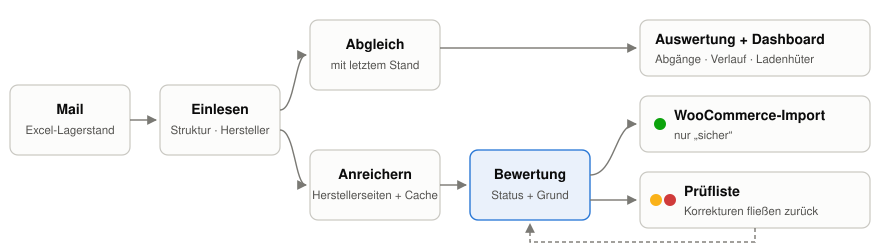
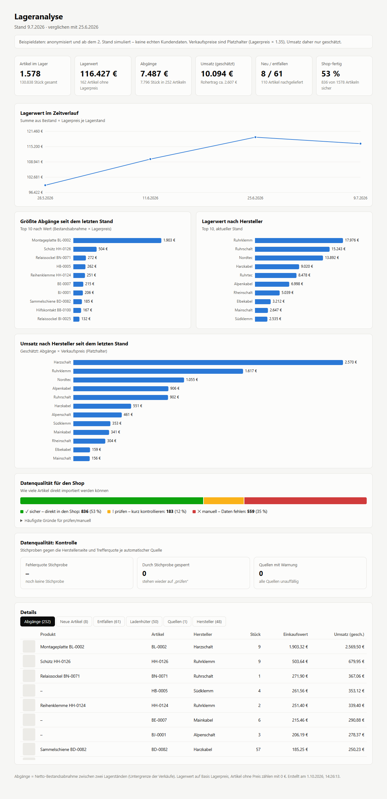

# Lageranalyse für einen Elektro-Onlineshop

**Fallstudie.** Wie aus einer Excel-Liste mit Nummern und Beständen ein Onlineshop-Sortiment mit Namen, Beschreibungen und
Bildern wird, das sich bei jeder neuen Lieferung selbst aktualisiert, und welche Entscheidungen dabei die wichtigen waren.

**[▶ Live-Demo des Dashboards](https://conny-codes.github.io/lageranalyse-onlineshop/)** (anonymisierte Beispieldaten)

> **Zum Quelltext:** Dieses Repository zeigt Lösungsweg, Entwurfsentscheidungen, ausgewählte Codeauszüge und anonymisierte
> Beispieldaten, **nicht** den vollständigen Code. Die Pipeline läuft produktiv mit echten Lieferantendaten. Den ganzen
> Code zeige ich gern im Gespräch oder auf Anfrage in einem privaten Repository.

---

## Das Problem

Ein Großhändler für Elektrotechnik schickt regelmäßig seinen Lagerbestand per E-Mail, als Excel-Liste mit rund 1.800
Artikeln. Daraus soll ein Onlineshop entstehen, und man will verstehen, was sich verkauft.

Die Liste enthält aber nur das Nötigste für ein Lager, nichts für einen Shop:

| Spalte | Beispiel | Problem |
|---|---|---|
| Artikelnummer | `PHO-ST 6` | interne Nummer, der Hersteller steckt nur im Kürzel |
| Bestellnummer | `3031364` | meist die echte Herstellernummer, manchmal Platzhalter wie „Baumarkt“ |
| Hersteller | *(leer)* | bei allen Artikeln leer |
| Bestand | `12` | eine Momentaufnahme, keine Verkäufe |
| Lagerpreis | `4,83` | Einkaufsbasis, kein Verkaufspreis |

1.800 Produkte von Hand nachzuschlagen, bedeutet Wochen Arbeit. Und mit der nächsten Liste beginnt alles von vorn.

---

## Die Lösung in einem Bild



```
Mail vom Lieferanten → Google Drive → Einlesen → Abgleich mit letztem Stand → Herstellerseiten abfragen
                                                                                     │
           Shop-Import (nur „sicher“)  ◄──  Status: sicher / prüfen / manuell  ◄──────┘
           Prüfliste mit Begründung                       ▲
           Dashboard                     KI-Recherche für Sonderfälle, Stichproben, Quellen-Alarm
```

Drei Bausteine:

1. **Ein Mail-Eingang ohne Server:** Ein Google Apps Script holt stündlich die Anhänge des Lieferanten aus Gmail und legt
   sie datiert in Google Drive ab. Eine Windows-Aufgabe verarbeitet jede neue Datei genau einmal.
2. **Eine Python-Pipeline:** Sie liest die Liste ein, gleicht sie mit dem letzten Stand ab, holt Produktdaten von den
   Herstellerseiten und schreibt WooCommerce-Import, Prüfliste, Excel-Auswertung und Dashboard.
3. **Eine Qualitätsschicht:** Jeder Artikel bekommt einen Status mit Begründung. Was das Programm nicht lösen kann,
   recherchiert eine KI-Stufe (Claude). In den Shop geht nur, was bestätigt ist.

---

## Bildschirmfotos

**Das Dashboard:** Lagerwert im Verlauf, größte Abgänge, Umsatz nach Hersteller, Datenqualität und Details mit
Produktbild. Es ist eine einzelne HTML-Datei ohne Bibliotheken, mit Tooltips und Dark Mode.
→ [Live ausprobieren](https://conny-codes.github.io/lageranalyse-onlineshop/)



---

## Vier Entscheidungen, die den Unterschied gemacht haben

### 1. Die Herstellerseite fragen, nicht eine Suchmaschine

Die Bestellnummer ist beim Hersteller eindeutig. Statt zu suchen und zu raten, öffnet das Programm für jeden Hersteller
dessen Produktseite nach einem festen Adressmuster, also `eaton.com/…/skuPage.{nummer}.html` oder `lapp.com/…/p/{nummer}`.
Das ist schnell, kostenlos und jedes Mal gleich.

Der Haken: Fast alle Herstellerseiten blocken einfache Abrufe. Gesteuert wird deshalb der installierte Edge-Browser per
Playwright, mit dem Fenster außerhalb des sichtbaren Bereichs. Jeder Hersteller hat seine Eigenheiten. Lapp zeigt nur
die Serie, und die Variante steht im Text. Eaton nennt den Typ nur in der Überschrift. Phoenix landet manchmal auf einer
Trefferliste. Diese Unterschiede stecken in einer Konfiguration je Quelle, nicht im Code
([Auszug](code/anreichern_auszug.py)).

### 2. Ein Treffer zählt nur, wenn die Nummer auf der Seite steht, und zwar als ganzes Wort

Die erste Fassung prüfte, ob die Nummer *irgendwo* vorkommt. Gesucht war `24680`, gefunden wurde ein Rahmen mit der
Nummer `246801`. Seitdem gilt:

```python
def nummer_bestaetigt(nr, text):
    ziel = normiere(nr)   # "5ST3770-0" und "5ST37700" sind dieselbe Nummer …
    return any(normiere(t) == ziel for t in re.split(r"[\s,;:()\[\]\"'|<>]+", text) if t)   # … "246801" nicht
```

Lieber ein Artikel mehr auf „prüfen“ als ein falsches Produkt im Shop.

### 3. „Gibt es nicht“ und „darf ich gerade nicht sehen“ sind zwei verschiedene Dinge

Bei 1.800 Abfragen sperren Hersteller irgendwann („Access Denied“). Die erste Fassung wertete das als „nicht gefunden“,
und 82 Eaton-Artikel galten fälschlich als unauffindbar. Heute unterscheidet das Programm drei Fälle:

| Seite zeigt | Bedeutung | Reaktion |
|---|---|---|
| das Produkt mit bestätigter Nummer | gefunden | speichern |
| eine echte Fehlerseite (404) | gibt es nicht | endgültig vermerken |
| eine Sperrseite | weiß ich nicht | nicht speichern, warten, nach 3 Sperren die Quelle für diesen Lauf zurückstellen |

Daraus entstand auch der **Quellen-Alarm**: Bricht die Trefferquote einer Quelle ein, steht oben im Dashboard eine
Warnung. Meist hat dann ein Hersteller seine Webseite umgebaut ([`code/qualitaet.py`](code/qualitaet.py)).

### 4. Programm für die Masse, KI für die Sonderfälle, Mensch für die Freigabe

| Wer | Macht | Warum |
|---|---|---|
| **Programm** | feste Quellen, Abgleich, Exporte | deterministisch, schnell, kostenlos, nachvollziehbar |
| **KI (Claude)** | kleine Hersteller, unbekannte Kürzel, Platzhalter-Nummern, Typcodes deuten | kann mit unstrukturierten Fällen umgehen |
| **Mensch** | Freigabe von allem, was nicht eindeutig bestätigt ist | trägt die Verantwortung für den Shop |

Die KI-Recherche läuft als tägliche geplante Aufgabe. Sie setzt einen Artikel nur dann auf „sicher“, wenn die
Bestellnummer auf der **offiziellen Herstellerseite** steht. Alles andere landet als Vorschlag mit Quelle in der Prüfliste.

Der größte Hebel war dabei nicht die Recherche je Artikel, sondern **wiederkehrende Muster ins Programm zu übernehmen**.
Lapp (139 Artikel) und Lovato (17) liefen anfangs über die KI und laufen jetzt automatisch. Jeder Artikel bekommt einen
Status mit Begründung ([`code/bewertung.py`](code/bewertung.py)), und Korrekturen aus der Prüfliste fließen beim nächsten
Lauf zurück.

---

## Codeauszüge

| Datei | Worum es geht |
|---|---|
| [`code/anreichern_auszug.py`](code/anreichern_auszug.py) | Quellen-Konfiguration, Bestätigung über die Nummer, gefunden / gibt es nicht / gesperrt, Neuabfrage bei verbesserter Quelle |
| [`code/bewertung.py`](code/bewertung.py) | Die Statuslogik: sicher / prüfen / manuell mit Begründung, Korrekturen und Stichproben-Sperren |
| [`code/abgleich.py`](code/abgleich.py) | Zwei Lagerstände vergleichen: Abgänge, Zugänge, neue und entfallene Artikel, Wert- und Umsatzänderung |
| [`code/qualitaet.py`](code/qualitaet.py) | Quellen-Alarm und Stichprobenkontrolle |
| [`code/gmail_zu_drive.gs`](code/gmail_zu_drive.gs) | Google Apps Script: Lagerlisten aus Gmail in Google Drive ablegen |

---

## Beispieldaten

[`beispiel/`](beispiel/) enthält vier **anonymisierte und ab dem zweiten Stand simulierte** Lagerstände und die
Ausgaben des letzten Laufs: Dashboard, Prüfliste, Excel-Auswertung und WooCommerce-Import. Artikel- und Bestellnummern
sind ersetzt, Herstellernamen erfunden, Preise und Bestände verfremdet.

---

## Was schiefging und was ich daraus gelernt habe

| Problem | Wie entdeckt | Lösung |
|---|---|---|
| Kurze Nummern trafen falsche Produkte | Test neuer Quellen | Nummer muss als ganzes Wort auf der Seite stehen |
| 108 Einträge waren Suchergebnisseiten statt Produkte | Durchsicht der Recherche-Liste | Trefferlisten auflösen, Suchseiten nie als Produkt werten |
| Sperrseiten galten als „nicht gefunden“ | auffällig hohe Fehlerquote einer Quelle | drei Fälle unterscheiden, Quellen-Alarm |
| Produktnamen ohne Typbezeichnung | wöchentliche Stichprobe | Typ aus der Überschrift übernehmen |
| Bereits lösbare Fälle landeten in der KI-Recherche | Auswertung des ersten Recherche-Laufs | Versionsprüfung auch für ältere Cache-Einträge |

**Lehre:** Ein Fehler im Programm trifft hunderte Datensätze auf einmal, fällt aber auf und ist einmal behoben.
Deshalb gehören Kontrollen von Anfang an dazu: Stichprobe, Alarm und eine Begründung für jeden Status.

---

## Grenzen der Analyse

- **Abgang ist nicht gleich Verkauf.** Zwischen zwei Lagerständen sieht man nur die Netto-Differenz. Verkauf und
  Nachlieferung im selben Zeitraum gleichen sich aus. Abgänge sind eine **Untergrenze** der Verkäufe.
- **Verkaufspreise und Umsatz sind vorerst Platzhalter** (Lagerpreis × Aufschlag).
- **Ladenhüter** heißt: kein Abgang über alle vorliegenden Stände. Die Aussage wird mit jeder Lieferung belastbarer.
- **20 von 20 Stichproben korrekt** heißt nur grob „Fehlerquote wahrscheinlich unter 15 %“. Die Zahl wird mit jeder
  Woche genauer.

---

## Aufbau

Ablauf, Module und Datenhaltung im Detail stehen in **[docs/architektur.md](docs/architektur.md)**, Statuslogik und
Kontrollen in **[docs/datenqualitaet.md](docs/datenqualitaet.md)**.

Dort steht auch, was ich heute anders machen würde.

---

## Zahlen

- **~1.800 Artikel** je Lagerliste, **78 %** davon über automatische Quellen abgedeckt (15 Herstellerkürzel)
- **932 Produkte** automatisch mit Name, Beschreibung und Bild angereichert
- **20 / 20** Stichproben korrekt, **18 / 20** im ersten Machbarkeitstest gefunden
- **~1.900 Zeilen** Quelltext, davon das Dashboard 350 Zeilen HTML/JS ohne Bibliotheken
- **2 Abhängigkeiten:** openpyxl und Playwright

---

## Technik

Python 3.12 · openpyxl · Playwright (Edge) · Google Apps Script · Google Drive · Windows-Aufgabenplanung ·
WooCommerce-CSV · HTML/SVG/JavaScript ohne Framework · Claude (Anthropic) als Recherche-Stufe und Programmierpartner

pandas kam bewusst nicht zum Einsatz: Auf dem Zielrechner blockiert eine Windows-Sicherheitsrichtlinie die Bibliothek,
und für 2.000 Zeilen reicht reines Python.

---

## Arbeitsweise

Entwickelt im Dialog mit **Claude Code** als Programmierpartner. Problemstellung, Anforderungen, Entscheidungen und die
Abnahme jedes Schritts lagen bei mir. Die Fehler in der Tabelle oben sind in diesem Prozess aufgefallen und behoben worden.
